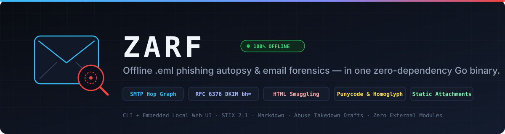
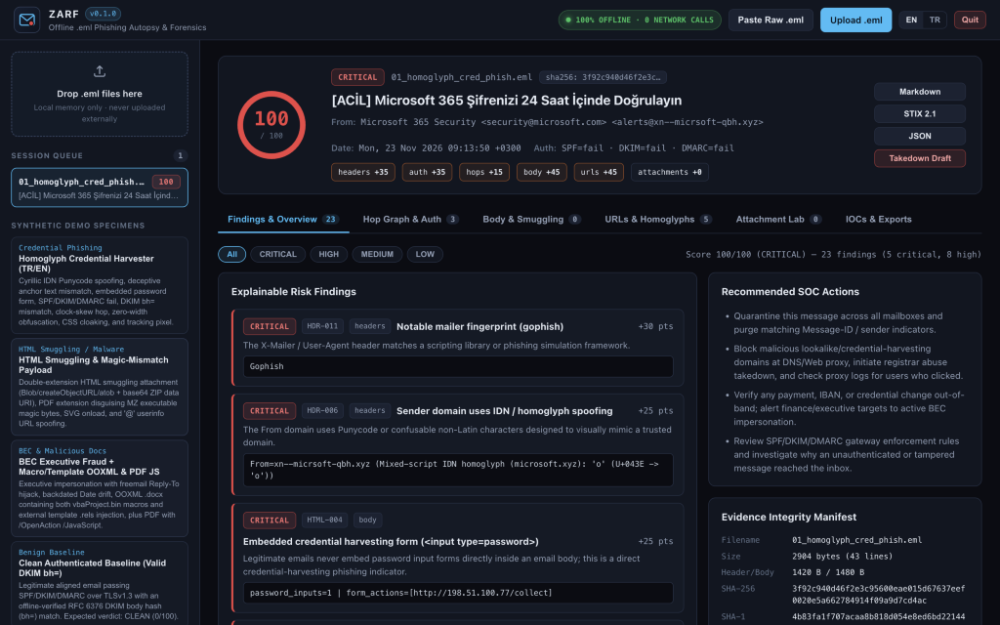
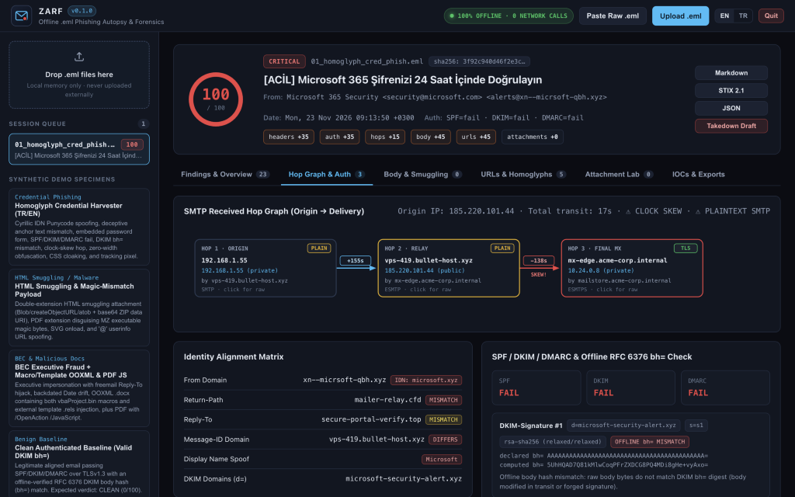
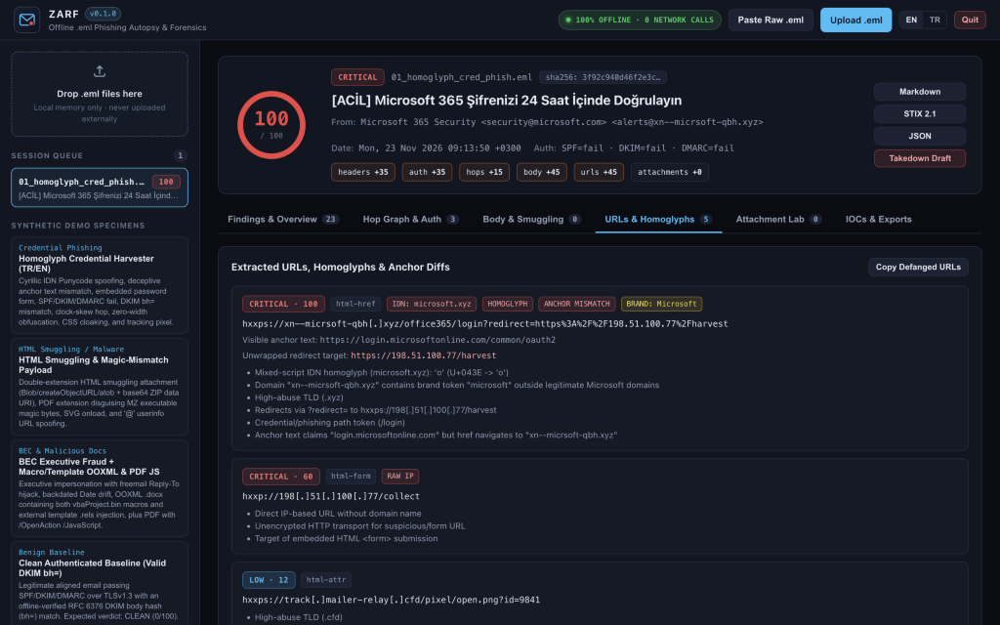
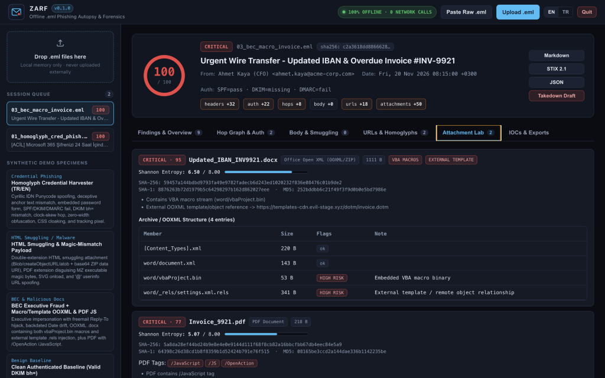

<p align="center">
  
</p>

<p align="center">
  <a href="https://github.com/gorkemguler/zarf/actions/workflows/ci.yml"></a>
  <a href="https://github.com/gorkemguler/zarf/releases/latest"></a>
  
  
  
  
  <a href="LICENSE"></a>
</p>

<p align="center">
  <strong>🇬🇧 English</strong> · <a href="README.tr.md">🇹🇷 Türkçe</a>
</p>

<p align="center">
  Open-source, single-binary, zero-dependency Go workbench for <strong>100% offline <code>.eml</code> phishing autopsy and email forensics</strong>.<br>
  Dissect SMTP hop chains, verify RFC 6376 DKIM body hashes offline, unpack HTML smuggling payloads, decode Punycode homoglyphs, and inspect malicious attachments without sending a single byte to the internet.
</p>

<p align="center">
  ⭐ If Zarf helps your SOC, CTI, or DFIR workflow, consider starring the repository.
</p>

---

## Table of Contents

- [Screenshots](#screenshots)
- [Why Zarf?](#why-zarf)
- [Download & Install (macOS, Windows, Linux)](#download--install)
- [Capabilities](#capabilities)
- [CLI Usage & Terminal Output](#cli-usage--terminal-output)
- [Embedded Offline Web UI](#embedded-offline-web-ui)
- [Explainable Scoring Rules](#explainable-scoring-rules)
- [Built-in Synthetic Specimens](#built-in-synthetic-specimens)
- [Local REST API](#local-rest-api)
- [Security & Offline Guarantees](#security--offline-guarantees)
- [Build & Release From Source](#build--release-from-source)
- [License](#license)

---

## Screenshots



<table>
  <tr>
    <td width="50%"><br><sub><b>Hop Graph &amp; Auth</b> — Interactive SVG SMTP relay path with clock-skew detection, Identity Alignment Matrix, and offline RFC 6376 DKIM <code>bh=</code> verification.</sub></td>
    <td width="50%"><br><sub><b>URLs &amp; Homoglyphs</b> — Pure-Go RFC 3492 Punycode decode (<code>xn--micrsoft-qbh.xyz</code> → <code>micrоsoft.xyz</code>), mixed-script Cyrillic detection, anchor-vs-href diff, and redirect unwrapping.</sub></td>
  </tr>
  <tr>
    <td colspan="2"><br><sub><b>Attachment Lab</b> — Static inspection of OOXML/ZIP structures (<code>word/vbaProject.bin</code>, <code>TargetMode="External"</code> template injection), PDF active tags (<code>/JavaScript</code>, <code>/OpenAction</code>), magic-byte mismatches, and Shannon entropy.</sub></td>
  </tr>
</table>

<sub>All screenshots show Zarf running 100% locally against built-in harmless synthetic specimens.</sub>

---

## Why Zarf?

**Zarf** (*Turkish for "envelope"*) was built for Threat Intelligence analysts, SOC responders, and DFIR investigators who cannot upload sensitive corporate emails to third-party cloud sandboxes:

- **Zero third-party Go dependencies** — `go.mod` contains zero `require` directives. Everything (RFC 3492 Punycode decoder, RFC 6376 DKIM body canonicalizer, OOXML/ZIP/OLE2/PDF/LNK static parsers, STIX 2.1 generator, embedded Web UI) is pure Go standard library.
- **Zero outbound network calls** — enforced end-to-end. The embedded Web UI ships zero external fonts or CDNs, enforces a strict `Content-Security-Policy: default-src 'self'`, and renders HTML email previews inside `<iframe sandbox="">` with all remote tracking pixels stripped and replaced by local placeholders.
- **Single binary for CLI + Desktop Web UI** — run `zarf inspect` in automated SOAR pipelines or double-click the macOS/Windows/Linux app package for an interactive bilingual (**EN / TR**) forensic workbench.
- **Explainable 0–100 risk scoring** — every point maps to a transparent rule ID (`HDR-*`, `AUTH-*`, `HOP-*`, `HTML-*`, `URL-*`, `ATT-*`) with exact evidence strings and SHA-256 chain-of-custody proof.

---

## Download & Install

Pre-built packages for **macOS**, **Windows**, and **Linux** (including **ARM64 / Raspberry Pi**) are published on the [**Releases**](https://github.com/gorkemguler/zarf/releases/latest) page.

### macOS (Apple Silicon & Intel)

1. **Desktop App (Recommended):** Download **`Zarf_0.1.0_macos_universal.dmg`** (or `Zarf_0.1.0_macos_universal_app.zip`), drag **`Zarf.app`** into `/Applications`, and double-click to open the local workbench (you can also drag `.eml` files onto `Zarf.app`).
   > **Note on unsigned open-source macOS apps:** On first launch macOS Gatekeeper may warn that the app is not notarized. Clear the quarantine flag once if needed:
   > ```bash
   > xattr -dr com.apple.quarantine /Applications/Zarf.app
   > ```
2. **CLI Tarball:** Download `zarf_0.1.0_darwin_arm64.tar.gz` (Apple Silicon) or `zarf_0.1.0_darwin_amd64.tar.gz` (Intel):
   ```bash
   tar -xzf zarf_0.1.0_darwin_arm64.tar.gz
   sudo install -m 755 zarf_0.1.0_darwin_arm64/zarf /usr/local/bin/zarf
   ```

### Windows (x64 & ARM64)

Download **`zarf_0.1.0_windows_amd64.zip`** (or `zarf_0.1.0_windows_arm64.zip`) and extract anywhere:

- **Double-click `Start-Zarf-App.cmd`** — launches the offline Web UI and opens your browser automatically.
- **Drag & drop any `.eml` onto `Inspect-EML-DragDrop.cmd`** — opens that email preloaded inside Zarf.
- **CLI (PowerShell / CMD):**
  ```powershell
  .\zarf.exe inspect samples\01_homoglyph_cred_phish.eml
  .\zarf.exe batch samples\
  ```

### Linux (Debian / Ubuntu / Kali / Raspberry Pi OS & Portable Tarball)

1. **Debian / Ubuntu / Kali / Raspberry Pi (`.deb`):**
   ```bash
   # x86_64
   sudo dpkg -i zarf_0.1.0_linux_amd64.deb

   # ARM64 (Raspberry Pi 4/5, ARM servers)
   sudo dpkg -i zarf_0.1.0_linux_arm64.deb
   ```
   Installs `/usr/local/bin/zarf`, desktop launcher (`/usr/share/applications/zarf.desktop` with `message/rfc822` `.eml` file association), and scalable vector icon.

2. **Any Linux distro (`.tar.gz`, static `CGO_ENABLED=0` binary):**
   ```bash
   tar -xzf zarf_0.1.0_linux_amd64.tar.gz
   cd zarf_0.1.0_linux_amd64
   ./install.sh
   ```

### Verify Checksums

Every release ships a `SHA256SUMS.txt` manifest:

```bash
shasum -a 256 -c SHA256SUMS.txt --ignore-missing
# or on Linux:
sha256sum -c SHA256SUMS.txt --ignore-missing
```

---

## Capabilities

| Module | Offline Forensic Coverage |
| :--- | :--- |
| **RFC 5322 & MIME** | Lossless raw header/body split, SHA-256 / SHA-1 / MD5 evidence manifest, RFC 2047 decoding (UTF-8, ISO-8859-1, ISO-8859-9, Windows-1252, Windows-1254 Turkish), lenient Base64 & Quoted-Printable, recursive `message/rfc822` nested `.eml` autopsy |
| **Identity & BEC** | Multi-part eTLD+1 org-domain alignment (`.com.tr`, `.gov.tr`, `.co.uk`, etc.), `From` vs `Return-Path` vs `Reply-To` checks, corporate-to-freemail `Reply-To` BEC fraud detection, display-name embedded email & brand spoofing (global + Turkish targets), `Message-ID` mismatch, phishing framework fingerprints (`Gophish`, `Evilginx`, `King Phisher`, `SET`) |
| **SMTP Hop Graph** | Chronological `Received:` relay reconstruction (`Origin → Relay → Final MX`), IPv4/IPv6 public/private/loopback classification, hop-to-hop transit deltas, negative clock-skew (`< -60s`) & long delay warnings, unencrypted external SMTP hops, `Date` header drift (`> 24h`) |
| **Auth & Offline DKIM** | `Authentication-Results`, `ARC-Authentication-Results`, and `Received-SPF` parsing **plus genuine RFC 6376 `simple`/`relaxed` body canonicalization** verifying every `DKIM-Signature` `bh=` digest against the raw body offline; catches body tampering, weak `rsa-sha1`, missing `from` in `h=`, and `l=` length-truncation attacks |
| **HTML Smuggling & Stealth** | Detects `Blob`, `URL.createObjectURL`, `msSaveOrOpenBlob`, `atob`, `Uint8Array`, `eval`, `document.write`, `<script>`, `<iframe srcdoc>`, `<svg onload>`, `<meta refresh>`; decodes & inspects embedded base64 `data:` URI payloads (SHA-256 + magic bytes); detects `<input type="password">` credential harvesters, CSS cloaking (`display:none`, `opacity:0`, `font-size:0`), zero-width chars, and BiDi overrides (`U+202E` RLO) |
| **URL & Homoglyphs** | Pure-Go RFC 3492 Punycode (`xn--`) decoder, Cyrillic/Greek/Latin mixed-script homoglyph skeleton analysis, anchor-text vs `href` mismatch, `@` userinfo authority spoofing, raw/decimal/hex IP URLs, open-redirect parameter unwrapping, URL shorteners, high-abuse TLDs, Levenshtein brand lookalikes, and analyst-safe defanging (`hxxps://`, `[.]`) |
| **Static Attachment Lab** | SHA-256/SHA-1/MD5, Shannon entropy (`0.00–8.00`), binary magic-byte identification vs extension mismatch, double-extension & RLO filename spoofing; **OOXML/ZIP** member inspection (`vbaProject.bin`, `.rels` `TargetMode="External"` remote template injection, encrypted entries, dangerous nested files, zip-bomb ratios), **OLE2** VBA strings, **PDF** (`/JavaScript`, `/JS`, `/OpenAction`, `/AA`, `/Launch`, `/EmbeddedFile`, `/URI`), **Windows `.lnk`** UTF-16LE/ASCII LOLBin strings, recursive HTML/SVG smuggling scan |
| **SOC & CTI Exports** | Rich ANSI terminal report, JSON, SOC Markdown report, **STIX 2.1 JSON Bundle** (`email-message`, `ipv4-addr`, `domain-name`, `url`, `file`, `indicator`, `report`), defanged IOCs, and ready-to-send **EN / TR Abuse & Phishing Takedown drafts** |

---

## CLI Usage & Terminal Output

```bash
# Dissect a single .eml file (or pipe via stdin with '-')
zarf inspect suspicious.eml
cat suspicious.eml | zarf inspect -

# Batch triage an entire directory (sorted highest risk first)
zarf batch ./quarantine/

# Run built-in synthetic phishing specimens
zarf demo --sample homoglyph-cred-phish
zarf demo --sample all

# Export STIX 2.1 bundle, Markdown SOC report, Defanged IOCs, or Takedown draft
zarf inspect --format stix --out case.stix21.json suspicious.eml
zarf inspect --format md --out triage.md suspicious.eml
zarf inspect --format iocs suspicious.eml
zarf inspect --format takedown --lang en suspicious.eml
zarf inspect --format takedown --lang tr suspicious.eml

# CI / SOAR gate: exit with code 2 when phishing risk score >= 50
zarf inspect --fail-above 50 suspicious.eml
```

<details>
<summary><b>Sample CLI output (<code>zarf inspect samples/01_homoglyph_cred_phish.eml</code>)</b></summary>

```text
  ███████╗ █████╗ ██████╗ ███████╗
  ╚══███╔╝██╔══██╗██╔══██╗██╔════╝  v0.1.0  ·  100% offline · 0 network calls
    ███╔╝ ███████║██████╔╝█████╗
   ███╔╝  ██╔══██║██╔══██╗██╔══╝    file   01_homoglyph_cred_phish.eml (2904 bytes)
  ███████╗██║  ██║██║  ██║██║       sha256 3f92c940d46f2e3c95600eae015d67637eef...

  PHISHING RISK SCORE   CRITICAL   ████████████████████████████  100/100
  Categories: headers=35 · auth=35 · hops=15 · body=45 · urls=45 · attachments=0

  ── ENVELOPE & IDENTITY ─────────────────────────────────────────────────────────
  From         Microsoft 365 Security <security@microsoft.com> <alerts@xn--micrsoft-qbh.xyz>
  Return-Path  bounce-9841@mailer-relay.cfd
  Reply-To     verify-desk@secure-portal-verify.top
  Subject      [ACİL] Microsoft 365 Şifrenizi 24 Saat İçinde Doğrulayın
  Auth         SPF=fail · DKIM=fail · DMARC=fail
  DKIM #1      d=microsoft-security-alert.xyz s=s1 a=rsa-sha256 [bh=MISMATCH]

  ── FINDINGS (23) ───────────────────────────────────────────────────────────────
  CRITICAL  HDR-011   (+30)  Notable mailer fingerprint (gophish)
  CRITICAL  HDR-006   (+25)  Sender domain uses IDN / homoglyph spoofing
            │ From=xn--micrsoft-qbh.xyz (Mixed-script IDN homoglyph (micrоsoft.xyz): 'о' (U+043E -> 'o'))
  CRITICAL  HTML-004  (+25)  Embedded credential harvesting form (<input type=password>)
  CRITICAL  URL-001   (+25)  IDN / Homoglyph lookalike URL detected (2)
  CRITICAL  AUTH-004  (+22)  DKIM body hash mismatch (d=microsoft-security-alert.xyz)
  HIGH      URL-002   (+20)  Deceptive anchor text vs href mismatch (1)
            │ text="https://login.microsoftonline.com/common/oauth2" -> host=xn--micrsoft-qbh.xyz
```

</details>

---

## Embedded Offline Web UI

Launch the embedded localhost workbench from the same single binary:

```bash
# Desktop mode: start server + auto-open browser + enable UI 'Quit' button
zarf app

# Headless / server mode (defaults to 127.0.0.1:8088)
zarf serve
zarf serve --addr 127.0.0.1:9090 suspicious.eml
```

Web UI highlights:
- Multi-file drag & drop `.eml` queue + **Paste Raw `.eml`** modal
- 4 built-in synthetic demo specimens accessible with one click
- Interactive clickable **SVG SMTP Hop Graph**
- **Sandboxed zero-network HTML email preview** reporting every blocked remote tracking pixel host
- Bilingual **EN / TR** interface toggle and 1-click **Markdown / STIX 2.1 / JSON / Takedown** downloads

---

## Explainable Scoring Rules

Every finding adds transparent, category-capped points toward the final `0–100` verdict (`0–9 CLEAN`, `10–24 LOW`, `25–49 MEDIUM`, `50–74 HIGH`, `75–100 CRITICAL`):

| Prefix | Category | Key Rules |
| :--- | :--- | :--- |
| `HDR-001` – `HDR-011` | Headers & Identity | Return-Path/Reply-To mismatch, corporate→freemail BEC, display-name email/brand spoofing, IDN/homoglyph From domain, Message-ID mismatch, phishing mailer fingerprint |
| `AUTH-001` – `AUTH-008` | Authentication | SPF/DKIM/DMARC failures, **offline RFC 6376 DKIM `bh=` body-hash mismatch**, weak `rsa-sha1`, `l=` truncation tag, unsigned `From` |
| `HOP-001` – `HOP-004` | SMTP Hops | Missing `Received` trail, negative clock skew (`< -60s`), unencrypted public SMTP hop, `Date` header drift (`> 24h`) |
| `HTML-001` – `HTML-009` | Body & Smuggling | Blob/createObjectURL/SVG smuggling, suspicious decoded `data:` URI payloads, embedded `<input type="password">`, BiDi override / zero-width stealth chars, CSS cloaking |
| `URL-001` – `URL-007` | URLs & Homoglyphs | Punycode/homoglyph URL, deceptive anchor-text vs `href` mismatch, brand lookalike, raw IP URL, `@` userinfo spoof, URL shortener, open-redirect wrapper |
| `ATT-001` – `ATT-010`, `EML-001` | Attachments | RLO filename spoof, magic-byte vs extension mismatch, double extension, OOXML/OLE2 macros, OOXML external template `.rels`, HTML/SVG smuggling attachment, active PDF tags, encrypted ZIP, LNK/script LOLBins, high-risk nested `.eml` |

---

## Built-in Synthetic Specimens

All 4 specimens under `samples/` (and embedded inside the binary via `zarf demo`) are **100% benign, synthetic educational artifacts**:

1. `01_homoglyph_cred_phish.eml` — Cyrillic Punycode (`xn--micrsoft-qbh.xyz` → `micrоsoft.xyz`), anchor mismatch, embedded password form, tampered DKIM `bh=`, clock-skew hop, zero-width & CSS cloaking, tracking pixel (`100/100 CRITICAL`).
2. `02_html_smuggling_dropper.eml` — Double-extension `.pdf.html` HTML smuggling attachment (`Blob`/`createObjectURL`/`atob` + base64 ZIP `data:` URI), `.pdf` masquerading an `MZ` header, `<svg onload>`, `@` userinfo spoof (`100/100 CRITICAL`).
3. `03_bec_macro_invoice.eml` — Executive BEC with freemail `Reply-To` hijack, backdated `Date`, OOXML `.docx` with `vbaProject.bin` + `TargetMode="External"` template `.rels`, PDF with `/OpenAction` `/JavaScript` (`100/100 CRITICAL`).
4. `04_clean_authenticated.eml` — Aligned legitimate email passing SPF/DKIM/DMARC over TLSv1.3 with offline-verified RFC 6376 `bh=` match (`0/100 CLEAN`).

---

## Local REST API

When `zarf serve` or `zarf app` is running on `127.0.0.1:8088`:

| Method | Endpoint | Description |
| :--- | :--- | :--- |
| `GET` | `/api/health` | Version & offline status |
| `POST` | `/api/analyze` | Analyze multipart `file` upload or raw `message/rfc822` request body |
| `GET` | `/api/samples` | List built-in synthetic demo specimens |
| `POST` | `/api/samples/{id}` | Analyze a built-in specimen into the current session |
| `GET` | `/api/history` | List emails analyzed in the current in-memory session |
| `GET` | `/api/report/{id}` | Retrieve full forensic JSON report |
| `GET` | `/api/export/{id}/{format}` | Download `json`, `md`, `stix`, or `takedown?lang=en\|tr` |

---

## Security & Offline Guarantees

- **Zero network calls:** Zarf never initiates DNS lookups, HTTP requests, or WHOIS queries. Note that because DNS lookup is intentionally skipped offline, DKIM verification cryptographically checks the RFC 6376 body hash (`bh=`) locally while reporting that full public-key signature (`b=`) verification requires DNS.
- **No dynamic execution:** Attachments (PDF, OOXML, OLE2, LNK, HTML, SVG, PE) are parsed purely as byte arrays in memory — nothing is ever executed or written to temp folders.
- **Hardened local Web UI:** Binds to `127.0.0.1` by default, sets `Content-Security-Policy: default-src 'self'`, `X-Frame-Options: DENY`, `Referrer-Policy: no-referrer`, emits zero CORS headers, and isolates HTML previews in `<iframe sandbox="">` with remote resources stripped.

---

## Build & Release From Source

Requires **Go 1.24+** (no other Go dependencies):

```bash
git clone https://github.com/gorkemguler/zarf.git
cd zarf

# Run vet and race-enabled unit/integration tests
make vet
make test

# Build single binary for current OS/arch
make build

# Build cross-platform release bundles in dist/ (macOS DMG/app/tar.gz, Windows zip, Linux deb/tar.gz + SHA256SUMS.txt)
make release
```

---

## Related Open-Source Tools

Zarf fits naturally alongside other local-first security & CTI projects by [@gorkemguler](https://github.com/gorkemguler):
- **[MailVerity](https://github.com/gorkemguler/MailVerity)** — Explainable SPF, DKIM, and RFC 9989 DMARC domain auditing
- **[QuishScope](https://github.com/gorkemguler/QuishScope)** — Offline-first QR payload phishing inspection
- **[webdamga](https://github.com/gorkemguler/webdamga)** — Local web evidence archiving with SHA-256 integrity manifests
- **[isitakedown](https://github.com/gorkemguler/isitakedown)** & **[takedow.email](https://github.com/gorkemguler/takedow.email)** — Phishing takedown verification & abuse contact discovery
- **[Kanca](https://github.com/gorkemguler/Kanca)** — Intercepting HTTP/HTTPS proxy in Go
- **[tinfoil](https://github.com/gorkemguler/tinfoil)** — Zero-dependency local machine attack surface audit

---

## License

MIT — see [LICENSE](LICENSE).
