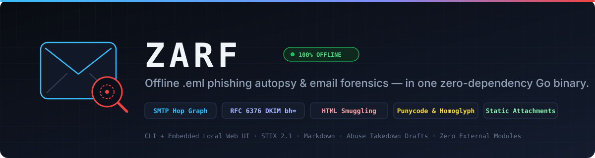
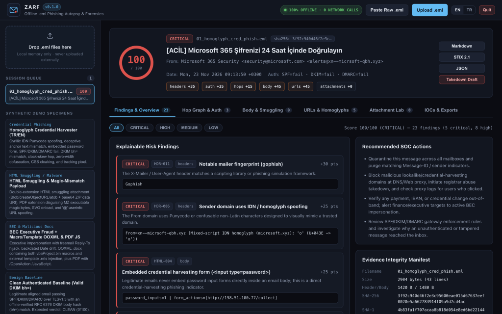
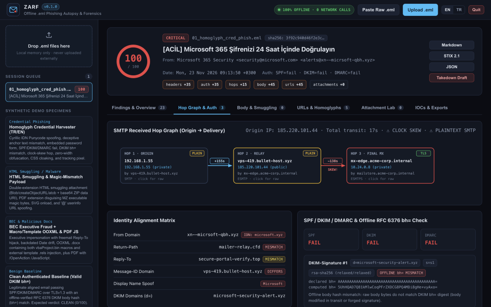
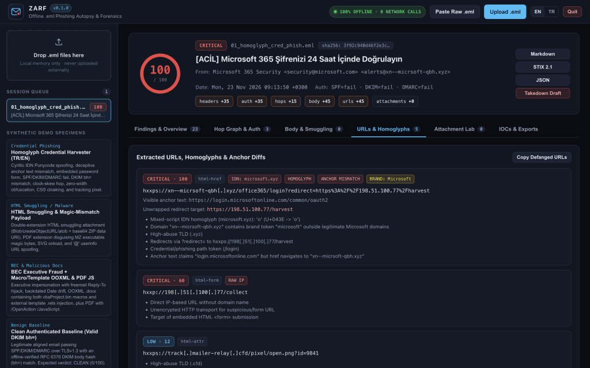
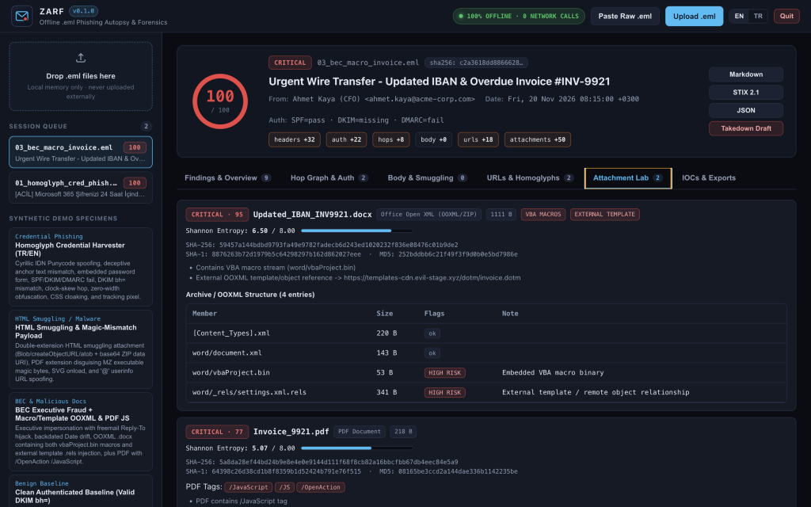

<p align="center">
  
</p>

<p align="center">
  <a href="https://github.com/gorkemguler/zarf/actions/workflows/ci.yml"></a>
  <a href="https://github.com/gorkemguler/zarf/releases/latest"></a>
  
  
  
  
  <a href="LICENSE"></a>
</p>

<p align="center">
  <a href="README.md">🇬🇧 English</a> · <strong>🇹🇷 Türkçe</strong>
</p>

<p align="center">
  Açık kaynaklı, sıfır dış bağımlılıklı, tek binary Go tabanlı <strong>%100 çevrimdışı <code>.eml</code> phishing otopsi ve e-posta adli analiz aracı</strong>.<br>
  İnternete tek bir bayt bile göndermeden SMTP hop grafiğini çıkarın, RFC 6376 DKIM gövde hash'lerini çevrimdışı doğrulayın, HTML smuggling yüklerini çözümleyin, Punycode homoglyph bağlantıları yakalayın ve ek dosyaların statik analizini yapın.
</p>

<p align="center">
  ⭐ Zarf SOC, CTI veya DFIR süreçlerinizde işinize yaradıysa repoya yıldız bırakabilirsiniz.
</p>

---

## İçindekiler

- [Ekran Görüntüleri](#ekran-görüntüleri)
- [Neden Zarf?](#neden-zarf)
- [İndirme & Kurulum (macOS, Windows, Linux)](#i̇ndirme--kurulum)
- [Yetenekler](#yetenekler)
- [CLI Kullanımı & Terminal Çıktısı](#cli-kullanımı--terminal-çıktısı)
- [Gömülü Çevrimdışı Web Arayüzü](#gömülü-çevrimdışı-web-arayüzü)
- [Açıklanabilir Risk Skorlama Kuralları](#açıklanabilir-risk-skorlama-kuralları)
- [Gömülü Sentetik Demo Örnekleri](#gömülü-sentetik-demo-örnekleri)
- [Yerel REST API](#yerel-rest-api)
- [Güvenlik & Çevrimdışı Garantileri](#güvenlik--çevrimdışı-garantileri)
- [Kaynaktan Derleme & Paketleme](#kaynaktan-derleme--paketleme)
- [Lisans](#lisans)

---

## Ekran Görüntüleri



<table>
  <tr>
    <td width="50%"><br><sub><b>Hop Grafiği &amp; Auth</b> — Saat sapması (clock skew) uyarıları içeren etkileşimli SVG SMTP röle grafiği, Kimlik Hizalama Matrisi ve çevrimdışı RFC 6376 DKIM <code>bh=</code> kontrolü.</sub></td>
    <td width="50%"><br><sub><b>URL &amp; Homoglyph</b> — Saf Go RFC 3492 Punycode çözümü (<code>xn--micrsoft-qbh.xyz</code> → <code>micrоsoft.xyz</code>), karışık Kiril alfabe tespiti, çapa metni / <code>href</code> farkı ve açık yönlendirme ayıklama.</sub></td>
  </tr>
  <tr>
    <td colspan="2"><br><sub><b>Ek Dosya Labı</b> — OOXML/ZIP yapı incelemesi (<code>word/vbaProject.bin</code>, <code>TargetMode="External"</code> uzak şablon enjeksiyonu), aktif PDF etiketleri (<code>/JavaScript</code>, <code>/OpenAction</code>), magic-byte uyuşmazlığı ve Shannon entropisi.</sub></td>
  </tr>
</table>

<sub>Tüm ekran görüntüleri, Zarf'ın gömülü zararsız sentetik örnekler üzerinde %100 yerel çalışmasından alınmıştır.</sub>

---

## Neden Zarf?

**Zarf**, hassas kurumsal e-postaları harici bulut analiz servislerine yükleyemeyen Threat Intelligence analistleri, SOC ekipleri ve DFIR uzmanları için tasarlandı:

- **Sıfır harici Go bağımlılığı** — `go.mod` içinde tek bir üçüncü parti `require` bulunmaz. RFC 3492 Punycode çözücü, RFC 6376 DKIM kanonikleştirici, OOXML/ZIP/OLE2/PDF/LNK statik ayrıştırıcıları, STIX 2.1 üreteci ve gömülü Web arayüzü tamamen Go standart kütüphanesiyle yazılmıştır.
- **Sıfır dış ağ çağrısı** — gömülü Web arayüzü harici font/CDN yüklemez, sıkı `Content-Security-Policy: default-src 'self'` uygular ve HTML e-posta önizlemesini `<iframe sandbox="">` içinde tüm uzak takip piksellerini (tracking pixel) engelleyerek gösterir.
- **Tek binary ile hem CLI hem Masaüstü Web Arayüzü** — SOAR / CI otomasyonlarında `zarf inspect` çalıştırın ya da macOS/Windows/Linux uygulama paketine çift tıklayarak **TR / EN** etkileşimli arayüzü açın.
- **Açıklanabilir 0–100 Risk Skoru** — her puan şeffaf bir kural kimliğine (`HDR-*`, `AUTH-*`, `HOP-*`, `HTML-*`, `URL-*`, `ATT-*`), birebir teknik kanıta ve SHA-256 delil bütünlük manifestosuna dayanır.

---

## İndirme & Kurulum

**macOS**, **Windows** ve **Linux** (x86_64 ve **ARM64 / Raspberry Pi** dahil) için hazır uygulama paketleri [**Releases**](https://github.com/gorkemguler/zarf/releases/latest) sayfasında yayınlanır.

### macOS (Apple Silicon & Intel — Universal)

1. **Masaüstü Uygulaması (Önerilen):** **`Zarf_0.1.0_macos_universal.dmg`** (veya `Zarf_0.1.0_macos_universal_app.zip`) paketini indirin, **`Zarf.app`** uygulamasını `/Applications` klasörüne sürükleyin ve çift tıklayarak çalıştırın (`.eml` dosyalarını doğrudan `Zarf.app` üzerine sürükleyebilirsiniz).
   > **İmzasız açık kaynak macOS uygulaması notu:** İlk açılışta macOS Gatekeeper uyarısı çıkarsa karantina bayrağını bir kez temizleyebilirsiniz:
   > ```bash
   > xattr -dr com.apple.quarantine /Applications/Zarf.app
   > ```
2. **CLI Paketi:** Apple Silicon için `zarf_0.1.0_darwin_arm64.tar.gz`, Intel için `zarf_0.1.0_darwin_amd64.tar.gz`:
   ```bash
   tar -xzf zarf_0.1.0_darwin_arm64.tar.gz
   sudo install -m 755 zarf_0.1.0_darwin_arm64/zarf /usr/local/bin/zarf
   ```

### Windows (x64 & ARM64)

**`zarf_0.1.0_windows_amd64.zip`** (veya `zarf_0.1.0_windows_arm64.zip`) arşivini açın:

- **`Start-Zarf-App.cmd` dosyasına çift tıklayın** — yerel çevrimdışı Web arayüzünü başlatır ve tarayıcıyı otomatik açar.
- **`.eml` dosyasını `Inspect-EML-DragDrop.cmd` üzerine sürükleyip bırakın** — ilgili e-posta doğrudan Zarf içinde açılır.
- **CLI (PowerShell / CMD):**
  ```powershell
  .\zarf.exe inspect samples\01_homoglyph_cred_phish.eml
  .\zarf.exe batch samples\
  ```

### Linux (Debian / Ubuntu / Kali / Raspberry Pi OS & Taşınabilir Arşiv)

1. **Debian / Ubuntu / Kali / Raspberry Pi (`.deb`):**
   ```bash
   # x86_64
   sudo dpkg -i zarf_0.1.0_linux_amd64.deb

   # ARM64 (Raspberry Pi 4/5, ARM sunucular)
   sudo dpkg -i zarf_0.1.0_linux_arm64.deb
   ```
   `/usr/local/bin/zarf` binary'sini, masaüstü menü başlatıcısını (`/usr/share/applications/zarf.desktop` — `.eml` dosya ilişkilendirmesi dahil) ve uygulama ikonunu kurar.

2. **Diğer Linux dağıtımları (`.tar.gz`, statik `CGO_ENABLED=0` binary):**
   ```bash
   tar -xzf zarf_0.1.0_linux_amd64.tar.gz
   cd zarf_0.1.0_linux_amd64
   ./install.sh
   ```

### SHA-256 Bütünlük Doğrulaması

```bash
sha256sum -c SHA256SUMS.txt --ignore-missing
# macOS üzerinde:
shasum -a 256 -c SHA256SUMS.txt --ignore-missing
```

---

## Yetenekler

| Modül | Çevrimdışı Adli Analiz Kapsamı |
| :--- | :--- |
| **RFC 5322 & MIME** | Kayıpsız başlık/gövde ayrımı, SHA-256 / SHA-1 / MD5 kanıt manifestosu, RFC 2047 (UTF-8, ISO-8859-1, ISO-8859-9, Windows-1252, Windows-1254 Türkçe), Base64 & Quoted-Printable, iç içe `message/rfc822` `.eml` özyinelemeli otopsi |
| **Kimlik & BEC** | Çok parçalı eTLD+1 domain hizalaması (`.com.tr`, `.gov.tr`, `.co.uk`), `From` / `Return-Path` / `Reply-To` karşılaştırması, kurumsal gönderenden freemail `Reply-To` BEC tespiti, görünen ad e-posta ve marka taklidi (global + Türkiye hedefli bankalar/kamu kurumları), `Gophish` / `Evilginx` mailer izleri |
| **SMTP Hop Grafiği** | Kronolojik `Received:` röle zinciri (`Kaynak → Röle → Son MX`), IPv4/IPv6 public/private sınıflandırması, hop gecikme süreleri, negatif saat atlaması (`< -60s` clock skew), şifresiz harici SMTP uyarısı, `Date` sapması (`> 24 saat`) |
| **Auth & Çevrimdışı DKIM** | `Authentication-Results`, `ARC`, `Received-SPF` ayrıştırması **+ gerçek RFC 6376 `simple`/`relaxed` gövde kanonikleştirmesi** ile her `DKIM-Signature` `bh=` özetinin çevrimdışı doğrulanması; gövde manipülasyonu, zayıf `rsa-sha1`, imzasız `From` ve `l=` kırpma saldırı tespiti |
| **HTML Smuggling & Gizleme** | `Blob`, `URL.createObjectURL`, `msSaveOrOpenBlob`, `atob`, `Uint8Array`, `eval`, `document.write`, `<script>`, `<iframe srcdoc>`, `<svg onload>`, `<meta refresh>`; gömülü base64 `data:` URI çözümleme ve magic-byte tespiti; `<input type="password">` formları, CSS gizleme (`display:none`, `opacity:0`, `font-size:0`), zero-width ve BiDi (`U+202E` RLO) karakterleri |
| **URL & Homoglyph** | Saf Go RFC 3492 Punycode (`xn--`) çözücü, Kiril/Yunan/Latin karışık alfabe homoglyph iskelet analizi, görünen çapa metni ile gerçek `href` uyuşmazlığı, `@` userinfo aldatmacası, ham/hex/ondalık IP URL'leri, açık yönlendirme parametresi ayıklama, link kısaltıcılar, marka typosquat skoru ve defanged çıktı (`hxxps://`, `[.]`) |
| **Statik Ek Dosya Labı** | SHA-256/SHA-1/MD5, Shannon entropisi (`0.00–8.00`), ikili magic-byte vs uzantı uyuşmazlığı, çift uzantı ve RLO dosya adı sahteciliği; **OOXML/ZIP** üye analizi (`vbaProject.bin`, `.rels` `TargetMode="External"` uzak şablon enjeksiyonu, şifreli arşiv, zip-bomb oranı), **OLE2** VBA izleri, **PDF** (`/JavaScript`, `/JS`, `/OpenAction`, `/Launch`, `/EmbeddedFile`, `/URI`), **Windows `.lnk`** LOLBin komut çıkarımı, HTML/SVG eklerde özyinelemeli smuggling taraması |
| **SOC & CTI Dışa Aktarım** | Zengin ANSI terminal raporu, JSON, SOC Markdown raporu, **STIX 2.1 JSON paketi** (`email-message`, `ipv4-addr`, `domain-name`, `url`, `file`, `indicator`, `report`), Defanged IOC listesi ve gönderime hazır **TR / EN Abuse & Takedown ihbar taslağı** |

---

## CLI Kullanımı & Terminal Çıktısı

```bash
# Tek bir .eml dosyasını incele (veya '-' ile stdin'den oku)
zarf inspect supheli.eml
cat supheli.eml | zarf inspect -

# Bir klasördeki tüm .eml dosyalarını toplu triyaj et (en riskliden temiz olana)
zarf batch ./karantina/

# Gömülü sentetik demo örneklerini çalıştır
zarf demo --sample homoglyph-cred-phish
zarf demo --sample all

# STIX 2.1, Markdown, Defanged IOC veya Türkçe/İngilizce Takedown taslağı üret
zarf inspect --format stix --out vaka.stix21.json supheli.eml
zarf inspect --format md --out rapor.md supheli.eml
zarf inspect --format iocs supheli.eml
zarf inspect --format takedown --lang tr supheli.eml

# CI / SOAR kapısı: risk skoru >= 50 ise çıkış kodu 2 döndür
zarf inspect --fail-above 50 supheli.eml
```

<details>
<summary><b>Örnek CLI çıktısı (<code>zarf inspect samples/01_homoglyph_cred_phish.eml</code>)</b></summary>

```text
  ███████╗ █████╗ ██████╗ ███████╗
  ╚══███╔╝██╔══██╗██╔══██╗██╔════╝  v0.1.0  ·  100% offline · 0 network calls
    ███╔╝ ███████║██████╔╝█████╗
   ███╔╝  ██╔══██║██╔══██╗██╔══╝    file   01_homoglyph_cred_phish.eml (2904 bytes)
  ███████╗██║  ██║██║  ██║██║       sha256 3f92c940d46f2e3c95600eae015d67637eef...

  PHISHING RISK SCORE   CRITICAL   ████████████████████████████  100/100
  Categories: headers=35 · auth=35 · hops=15 · body=45 · urls=45 · attachments=0

  ── ENVELOPE & IDENTITY ─────────────────────────────────────────────────────────
  From         Microsoft 365 Security <security@microsoft.com> <alerts@xn--micrsoft-qbh.xyz>
  Return-Path  bounce-9841@mailer-relay.cfd
  Reply-To     verify-desk@secure-portal-verify.top
  Subject      [ACİL] Microsoft 365 Şifrenizi 24 Saat İçinde Doğrulayın
  Auth         SPF=fail · DKIM=fail · DMARC=fail
  DKIM #1      d=microsoft-security-alert.xyz s=s1 a=rsa-sha256 [bh=MISMATCH]
```

</details>

---

## Gömülü Çevrimdışı Web Arayüzü

Aynı tek binary içinden etkileşimli yerel adli analiz arayüzünü açın:

```bash
# Masaüstü modu: sunucuyu başlat + tarayıcıyı otomatik aç + arayüzde 'Kapat' düğmesini göster
zarf app

# Sunucu modu (varsayılan 127.0.0.1:8088)
zarf serve
zarf serve --addr 127.0.0.1:9090 supheli.eml
```

---

## Açıklanabilir Risk Skorlama Kuralları

Her bulgu kategori tavanlarıyla birlikte `0–100` skoruna katkı yapar (`0–9 CLEAN`, `10–24 LOW`, `25–49 MEDIUM`, `50–74 HIGH`, `75–100 CRITICAL`):

| Kural Grubu | Kategori | Başlıca Kontroller |
| :--- | :--- | :--- |
| `HDR-001` – `HDR-011` | Başlık & Kimlik | Return-Path/Reply-To uyuşmazlığı, kurumsal→freemail BEC, görünen ad e-posta/marka taklidi, IDN/homoglyph gönderici, phishing mailer izi |
| `AUTH-001` – `AUTH-008` | Doğrulama | SPF/DKIM/DMARC hataları, **çevrimdışı RFC 6376 DKIM `bh=` gövde hash uyuşmazlığı**, zayıf `rsa-sha1`, `l=` kırpma etiketi, imzasız `From` |
| `HOP-001` – `HOP-004` | SMTP Hopları | Eksik `Received` zinciri, negatif saat sapması (`< -60s`), şifresiz harici SMTP, `Date` sapması (`> 24 saat`) |
| `HTML-001` – `HTML-009` | Gövde & Smuggling | Blob/createObjectURL/SVG smuggling, şüpheli çözümlenmiş `data:` URI yükü, `<input type="password">`, BiDi/zero-width gizleme, CSS cloaking |
| `URL-001` – `URL-007` | URL & Homoglyph | Punycode/homoglyph URL, çapa metni / `href` farkı, marka taklidi, ham IP URL, `@` userinfo aldatmacası, link kısaltıcı, açık yönlendirme |
| `ATT-001` – `ATT-010`, `EML-001` | Ek Dosyalar | RLO dosya adı, magic-byte / uzantı uyuşmazlığı, çift uzantı, OOXML/OLE2 makro, OOXML uzak şablon `.rels`, HTML/SVG smuggling eki, aktif PDF etiketleri, şifreli ZIP, LNK/script LOLBin, riskli iç içe `.eml` |

---

## Gömülü Sentetik Demo Örnekleri

`samples/` klasöründeki (ve binary içine gömülü `zarf demo`) 4 örnek **%100 zararsız, sentetik eğitim/test dosyalarıdır**:

1. `01_homoglyph_cred_phish.eml` — Kiril Punycode (`xn--micrsoft-qbh.xyz` → `micrоsoft.xyz`), çapa uyuşmazlığı, gömülü parola formu, bozulmuş DKIM `bh=`, saat sapmalı hop, zero-width & CSS gizleme, takip pikseli (`100/100 CRITICAL`).
2. `02_html_smuggling_dropper.eml` — Çift uzantılı `.pdf.html` smuggling eki (`Blob`/`createObjectURL`/`atob` + base64 ZIP `data:` URI), `MZ` ikili başlığı taşıyan sahte `.pdf`, `<svg onload>`, `@` userinfo aldatmacası (`100/100 CRITICAL`).
3. `03_bec_macro_invoice.eml` — Freemail `Reply-To` yönlendirmeli yönetici BEC, geri tarihli `Date`, `vbaProject.bin` + `TargetMode="External"` uzak şablonlu `.docx`, `/OpenAction` `/JavaScript` içeren `.pdf` (`100/100 CRITICAL`).
4. `04_clean_authenticated.eml` — TLSv1.3 üzerinden SPF/DKIM/DMARC geçen ve çevrimdışı RFC 6376 `bh=` eşleşmesi doğrulanan temiz e-posta (`0/100 CLEAN`).

---

## Yerel REST API

`zarf serve` veya `zarf app` `127.0.0.1:8088` üzerinde çalışırken:

| Metot | Uç Nokta | Açıklama |
| :--- | :--- | :--- |
| `GET` | `/api/health` | Sürüm ve çevrimdışı durum bilgisi |
| `POST` | `/api/analyze` | Multipart `file` yüklemesi veya ham `message/rfc822` gövde analizi |
| `GET` | `/api/samples` | Gömülü sentetik demo örneklerini listeler |
| `POST` | `/api/samples/{id}` | Seçilen sentetik örneği mevcut oturumda analiz eder |
| `GET` | `/api/history` | Oturum içi incelenen e-postaları listeler |
| `GET` | `/api/report/{id}` | Tam adli analiz JSON raporunu döndürür |
| `GET` | `/api/export/{id}/{format}` | `json`, `md`, `stix` veya `takedown?lang=tr\|en` çıktısı indirir |

---

## Güvenlik & Çevrimdışı Garantileri

- **Sıfır ağ isteği:** Zarf hiçbir DNS sorgusu, HTTP çağrısı veya WHOIS isteği yapmaz. Çevrimdışı ilkesi gereği DKIM kontrolü RFC 6376 gövde özetini (`bh=`) yerel olarak kriptografik biçimde doğrular; açık anahtar (`b=`) doğrulamasının DNS gerektirdiğini açıkça belirtir.
- **Dinamik çalıştırma yok:** PDF, OOXML, OLE2, LNK, HTML, SVG ve ikili ekler yalnızca bellekte ham bayt dizisi olarak incelenir; asla çalıştırılmaz veya geçici diske açılmaz.
- **Sıkılaştırılmış yerel Web UI:** Varsayılan olarak yalnızca `127.0.0.1` dinler, `Content-Security-Policy: default-src 'self'`, `X-Frame-Options: DENY` ve `Referrer-Policy: no-referrer` uygular, CORS başlığı yaymaz ve HTML önizlemelerini uzak kaynakları temizleyerek `<iframe sandbox="">` içinde izole eder.

---

## Kaynaktan Derleme & Paketleme

**Go 1.24+** yeterlidir (ek Go paketi indirmez):

```bash
git clone https://github.com/gorkemguler/zarf.git
cd zarf

# Vet ve race detector ile testler
make vet
make test

# Mevcut işletim sistemi için tek binary derle
make build

# Tüm platform paketlerini dist/ altında üret (macOS DMG/app/tar.gz, Windows zip, Linux deb/tar.gz + SHA256SUMS.txt)
make release
```

---

## İlgili Açık Kaynak Araçlar

Zarf, [@gorkemguler](https://github.com/gorkemguler) tarafından geliştirilen diğer local-first güvenlik ve CTI araçlarıyla doğrudan bütünleşir:
- **[MailVerity](https://github.com/gorkemguler/MailVerity)** — Açıklanabilir SPF, DKIM ve RFC 9989 DMARC alan adı denetimi
- **[QuishScope](https://github.com/gorkemguler/QuishScope)** — Çevrimdışı QR kod phishing analizi
- **[webdamga](https://github.com/gorkemguler/webdamga)** — SHA-256 bütünlük manifestolu yerel web delil arşivleme
- **[isitakedown](https://github.com/gorkemguler/isitakedown)** & **[takedow.email](https://github.com/gorkemguler/takedow.email)** — Phishing takedown doğrulama ve abuse iletişim bulucu
- **[Kanca](https://github.com/gorkemguler/Kanca)** — Go tabanlı HTTP/HTTPS güvenlik proxy'si
- **[tinfoil](https://github.com/gorkemguler/tinfoil)** — Sıfır bağımlılıklı yerel saldırı yüzeyi denetimi

---

## Lisans

MIT — bkz. [LICENSE](LICENSE).
